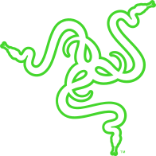
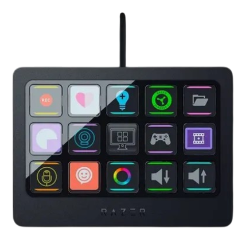

<b>STARGATE LABS · SIGNALRGB INTEGRATIONS</b> [Italiano](README.md) · [English](README.en.md) · [Installazione IT](docs/INSTALL-IT.md) · [Installation EN](docs/INSTALL-EN.md)

 &nbsp; 

# Razer Stream Controller X

Turn the deck into a continuous SignalRGB effect surface: **480 × 288 native pixels** across all 15 keys, with no logo added by the plugin. This lab release preserves the accepted Canvas sampling path and optimizes USB transfer preparation.

| Display | Color | Source |
|---|---|---|
| 480 × 288 · 15 × 96² tiles | RGB565 LE | Canvas default · LCD optional |

## Installation

Download the ZIP from [Releases](https://github.com/StargateLabs/signalrgb-razer-stream-controller-x/releases), extract it and follow the [English installation guide](docs/INSTALL-EN.md). Rollback instructions are included.

## Architecture and verification

Pixels → 96 × 96 rectangles → serial batch → one DRAW. Tests verify all **138,240 positions**, RGB565 bytes, unchanged-frame reuse and the 15 LCD-path rectangles. [Existing demo](assets/demo.mp4), recorded before this release.

## Known limits

Smoothness depends on the SignalRGB runtime, content and Windows power plan. The final lab Canvas sample reached approximately **8–9 fps** with High performance; this is not a guarantee for every PC. Optional LCD mode may include SignalRGB face/compositing. Use Canvas for the validated result.

## Documentation and contributions

- [Technical notes / Note tecniche](docs/TECHNICAL-EN.md)
- [Changelog](CHANGELOG.md)
- [Third-party notices](THIRD_PARTY_NOTICES.md)
- [MIT license](LICENSE)
- [Stargate Labs](https://github.com/StargateLabs) · [Lab portfolio](https://stargatelabs.github.io/StargateLabs/)

Independent project, not affiliated with Razer, SignalRGB, Tuya or LSC. Trademarks belong to their respective owners.

Observe. Decode. Build. Verify. — Created by Stargate Labs.
