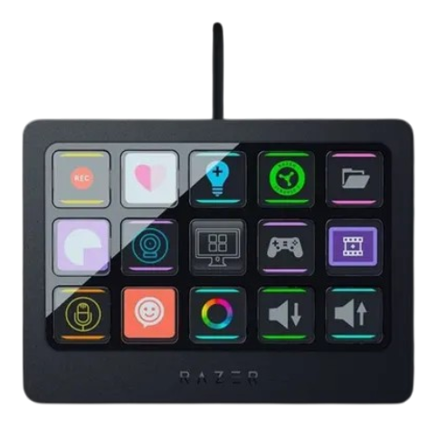

<b>STARGATE LABS · SIGNALRGB INTEGRATIONS</b> [Italiano](README.md) · [English](README.en.md) · [Installazione IT](docs/INSTALL-IT.md) · [Installation EN](docs/INSTALL-EN.md)

 &nbsp; 

# Razer Stream Controller X

Il deck diventa una superficie continua per gli effetti SignalRGB: **480 × 288 pixel nativi**, distribuiti sui 15 tasti senza un logo aggiunto dal plugin. La versione finale del laboratorio conserva il campionamento Canvas approvato e ottimizza la preparazione dei trasferimenti USB.

| Display | Color | Source |
|---|---|---|
| 480 × 288 · 15 × 96² tiles | RGB565 LE | Canvas default · LCD optional |

## Installazione

Scarica lo ZIP da [Releases](https://github.com/StargateLabs/signalrgb-razer-stream-controller-x/releases), estrailo e segui la [guida in italiano](docs/INSTALL-IT.md). Le istruzioni spiegano anche come tornare alla versione precedente.

## Architettura e verifiche

Pixel → rettangoli 96 × 96 → batch seriale → un solo DRAW. Il test verifica tutte le **138.240 posizioni**, i byte RGB565, il riuso dei frame invariati e i 15 rettangoli del percorso LCD. [Demo esistente](assets/demo.mp4), registrata prima di questo rilascio.

## Limiti dichiarati

La fluidità dipende dal runtime SignalRGB, dal contenuto e dal piano energetico Windows. Il campione finale Canvas ha raggiunto circa **8–9 fps** nel laboratorio con Prestazioni elevate: non è una garanzia per ogni PC. LCD è opzionale e può includere il face/compositing di SignalRGB; per il risultato validato usare Canvas.

## Documentazione e contributi

- [Technical notes / Note tecniche](docs/TECHNICAL-IT.md)
- [Changelog](CHANGELOG.md)
- [Third-party notices](THIRD_PARTY_NOTICES.md)
- [MIT license](LICENSE)
- [Stargate Labs](https://github.com/StargateLabs) · [Lab portfolio](https://stargatelabs.github.io/StargateLabs/)

Progetto indipendente, non affiliato a Razer, SignalRGB, Tuya o LSC. I marchi appartengono ai rispettivi titolari.

Observe. Decode. Build. Verify. — Created by Stargate Labs.
